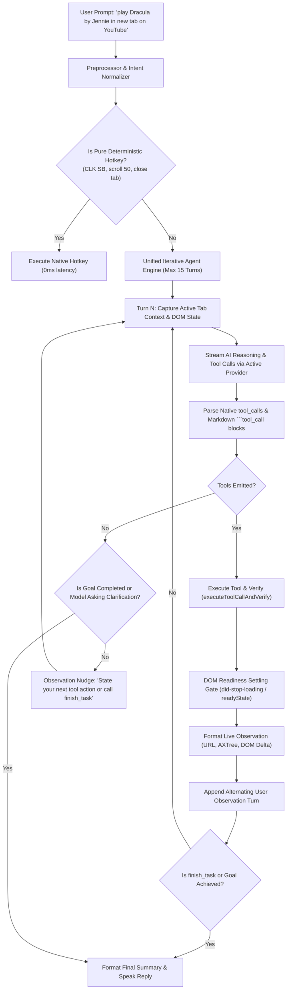

# Recursive AI Tool Calling & Harness Layer Fix — Implementation Plan

> **Goal:** Fix the harness layer so that multi-step browser commands (such as *"open YouTube in a new tab and play Dracula by Jennie"*) execute through a complete, robust recursive tool-calling loop until the entire goal is completed.

---

## 1. Executive Summary & Root Cause Analysis

### Identified Architectural Breakdowns
1. **Fragmented Routing in `executeAiBrowserCommand`:**  
   A rigid regex gate (`isAutonomousGoal`) checked exclusively for literal keywords like `"and then"` or `"download"`. Natural conversational prompts (e.g., *"play Dracula by Jennie in the new tab by opening YouTube"*) failed this check and were routed into a fallback single-shot dispatch.
2. **Severed Loop in Single-Shot Fallback:**  
   The fallback dispatch provided `BROWSER_TOOLS` to the model, executed the first tool call (`open_tab`), and then **immediately exited** with a verification message, completely lacking a re-entry loop to feed tool observations back to the AI.
3. **Message History Schema Corruption in `executeAutonomousAgentLoop`:**  
   `agentHistory` was accumulating an assistant message followed by two consecutive user messages without preserving proper turn alternation (`system` -> `user` -> `assistant` -> `user [tool observation]` -> `assistant`), causing chat template and API validation failures across multiple providers.
4. **Premature Termination on Explanatory Text:**  
   If the model replied with natural reasoning without a tool code block in turn 2, the loop immediately executed `completed = true; break;`, abandoning unfinished tasks.
5. **Asynchronous Webview Readiness Desync:**  
   After executing `open_tab` or `navigate`, the harness immediately extracted DOM state without waiting for the new Chromium webview to settle and load, giving the model blank or partial page observations on subsequent turns.

---

## 2. Proposed Architecture & Component Flow



---

## 3. Phased Implementation Tasks

### Phase 1: Unify Routing & Eliminate the Single-Turn Dead-End
* **File:** [`desktop/src/ai_harness_engine.js`](file:///c:/Users/Anurag/Desktop/ai/automated%20browser/desktop/src/ai_harness_engine.js)
* **Objective:** Ensure any non-trivial command requiring LLM comprehension or browser actions routes directly into the iterative loop.
* **Actions:**
  1. Refactor `executeAiBrowserCommand()` so that deterministic regexes exclusively handle atomic hotkeys (`scroll 0/1000/50`, `tab 1/2`, `reader mode`, `close tab`).
  2. Deprecate the fragile `isAutonomousGoal` regex gate.
  3. Direct all AI provider prompts requiring browser tools into the iterative loop (`executeAutonomousAgentLoop`).

### Phase 2: Repair Alternating Message History & ChatML Schema
* **File:** [`desktop/src/ai_harness_engine.js`](file:///c:/Users/Anurag/Desktop/ai/automated%20browser/desktop/src/ai_harness_engine.js)
* **Objective:** Guarantee valid OpenAI / Anthropic / ChatML turn alternation.
* **Actions:**
  1. **Turn 1 Message Setup:**  
     Seed history with:
     ```javascript
     messages = [
       { role: 'system', content: combinedSystemPrompt },
       { role: 'user', content: `User Goal: "${raw}"\n\nInitial Browser State:\n${turn1Observation}` }
     ];
     ```
  2. **Turn N Assistant Recording:**  
     Record `{ role: 'assistant', content: replyContent }` upon receiving model reply.
  3. **Turn N Tool Observation Recording:**  
     Format the tool result as a structured user observation turn:
     ```javascript
     {
       role: 'user',
       content: `[Tool Execution Observation - Turn ${turn}]\nAction: ${execRes.verification}\nDOM Delta: ${domDelta.summary}\nActive URL: ${currentUrl}\nTitle: "${currentTitle}"\nKey Elements Detected: ${detectedSummary}\n\nWhat is your next action toward the goal: "${raw}"? If finished, call finish_task.`
     }
     ```
  4. Ensure no consecutive `user` or `assistant` roles are transmitted.

### Phase 3: DOM Readiness & Navigation Settling Gate
* **File:** [`desktop/src/ai_harness_engine.js`](file:///c:/Users/Anurag/Desktop/ai/automated%20browser/desktop/src/ai_harness_engine.js)
* **Objective:** Prevent Turn 2 from querying a blank or half-mounted `<webview>` after `open_tab` or `navigate`.
* **Actions:**
  1. Implement `waitForWebviewSettled(webview, timeoutMs = 3000)`:
     - Polls `document.readyState === 'complete'` or checks if `webview.isLoading()` is false.
     - Ensures video players (YouTube), search inputs, or content elements are attached to the DOM before generating Turn 2 observation.
  2. When `open_tab` creates a new tab, immediately bind `liveActiveTabId` and wait for the new webview element to exist in the React DOM.

### Phase 4: Multi-Turn UI Streaming & Tool Event Accumulation
* **File:** [`desktop/src/components/AiHudSidebar.jsx`](file:///c:/Users/Anurag/Desktop/ai/automated%20browser/desktop/src/components/AiHudSidebar.jsx)
* **Objective:** Accurately display each turn's live thought stream and tool cards without clobbering.
* **Actions:**
  1. Ensure `onToolEvent` updates tool cards incrementally with turn indices (`Turn 1: open_tab`, `Turn 2: type_text`, `Turn 3: click_element`).
  2. Maintain live thought box updates across turns so the user visually sees the model thinking through each consecutive action.

### Phase 5: Verification & End-to-End Testing
* **Files:**
  - Build: `npm run build:react`
  - Automated test script: `tests/test_recursive_tool_calling.py`
* **Test Cases:**
  1. **Compound Navigation & Search:** *"can you play dracula song by jannie in the new tab by opening youtube"*
     - Turn 1: Emits `open_tab(url="https://www.youtube.com")`
     - Verification: Harness opens Tab, waits for DOM ready.
     - Turn 2: Model perceives YouTube search box, emits `type_text(target="search", text="dracula song by jennie", submit=true)`
     - Verification: YouTube search executes.
     - Turn 3: Model perceives search results, emits `click_element(target="Dracula Jennie")` or plays video.
     - Turn 4: Emits `finish_task` with success summary.
  2. **Multi-Field Form Filling:** Navigating to a page and typing multiple fields without premature exit.
  3. **Zero Regression Test:** Ensure instant hotkeys (`CLK SB`, `scroll 50`, `tab 2`) still execute with 0ms overhead.

---

## 4. Execution Readiness Checklist

- [x] Detailed root cause identified and validated against running workspace.
- [x] Architectural design maintains strict Ponytail tenets (native fetch, zero npm bloat).
- [x] Full compliance with Founder directive & workspace task completion rules.
- [ ] Implement Phase 1 & 2 in `ai_harness_engine.js`.
- [ ] Implement Phase 3 settling gate in `ai_harness_engine.js`.
- [ ] Build React bundle (`npm run build:react`).
- [ ] Run live end-to-end multi-turn tool calling verification.
