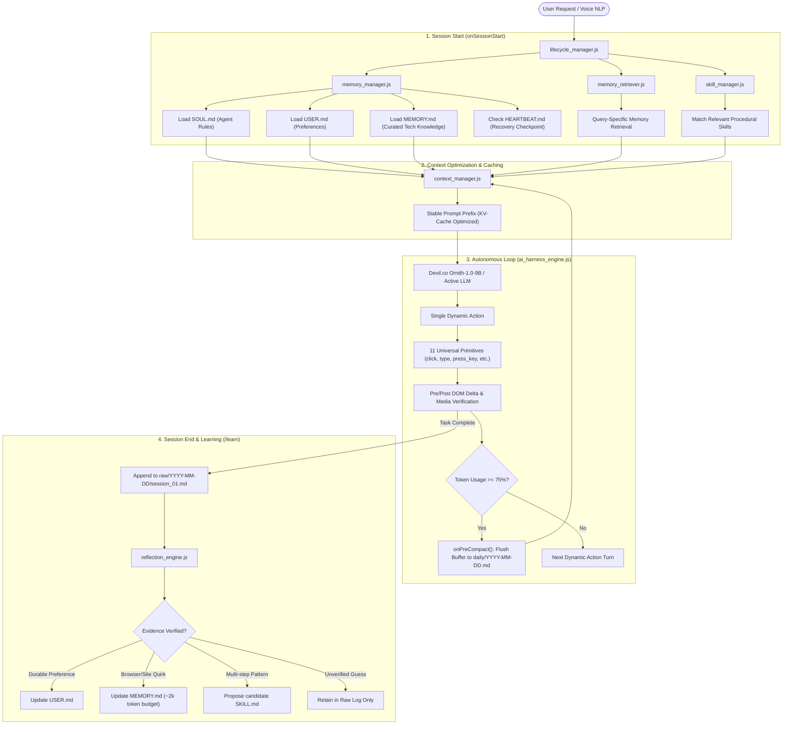

# Second Brain — Master Architecture & Implementation Plan
## 1. Executive Overview & System Topology
The Antigravity AI Browser currently executes commands in an ephemeral cycle: $$\text{User Request} \longrightarrow \text{Perception (AXTree / SoM)} \longrightarrow \text{Dynamic Action} \longrightarrow \text{Delta Verification} \longrightarrow \text{Context Lost on Session End}$$

The Second Brain converts the browser into a persistent, self-improving cognitive system: $$\text{User Request} \longrightarrow \text{Memory Retrieval} \longrightarrow \text{Context Assembly} \longrightarrow \text{Action} \longrightarrow \text{Verification} \longrightarrow \text{Consolidation} \longrightarrow \text{Skill Reuse}$$



## Core Architecture Tenets (Ponytail Senior Engineering Philosophy)
- **100% Markdown Storage with SQLite Summary Index**: Core truths and full interaction transcripts live in plain `.md` files. A lightweight local SQLite database (`memory_summaries.sqlite`) stores indexed session summaries, enabling sub-millisecond search across months of history.
- **90-Day Raw Chat Retention**: Full, unedited Markdown interaction transcripts are preserved for 90 days in `second brain/memory/raw/YYYY-MM-DD/session_<id>.md`.
- **Morning 8:00 AM Daily Reflection Routine**: Every morning at 8:00 AM, the reflection engine processes unsummarized past transcripts. Vital facts (authorized credentials/passwords, preferences, and platform workarounds) are promoted to `MEMORY.md` and `USER.md`, while structured session summaries are generated and indexed in SQLite.
- **On-Demand Full Raw Chat Retrieval**: Users and AI search summaries in SQLite first. When deeper detail is needed, the AI calls `read_raw_session({ session_id })` to pull the complete unedited transcript into working context—ensuring no ounce of memory is ever lost.
- **Codex-Style On-Demand Tool Paging**: The model prompt is never bloated with dozens of static tool schemas. Core browser primitives are always available, while specialized tools (Second Brain search, scrapers, extensions) are paged into context dynamically via a meta-tool.
- **Strict 3-Turn Sliding Window**: The active LLM prompt receives the current turn (prompt/observation + output) and strictly the last **3 previous turns** (prompt + results). Older turns are flushed to raw storage and omitted from prompt context.

## 2. Hybrid Markdown & SQLite Summary Memory Model (`second brain/memory/`)
```text
second brain/
  ├── memory_manager.js          <-- Safe atomic Markdown storage, SQLite indexing, 90-day retention
  ├── memory_retriever.js        <-- Fast SQLite summary search + on-demand full raw chat loader
  ├── context_manager.js         <-- Static KV prefix, Codex tool pager, strict 3-turn sliding window
  ├── skill_manager.js           <-- Hermes procedural skill registry & on-demand loader
  ├── reflection_engine.js       <-- Morning 8:00 AM daily reflection, password extraction, /learn
  ├── lifecycle_manager.js       <-- SessionStart, PreCompact, 8 AM cron, and SessionEnd hooks
  ├── skills/                    <-- Hermes procedural skill repository (SKILL.md)
  └── memory/                    <-- Dedicated Memory Storage Layer
      ├── SOUL.md                <-- Agent identity, moral boundaries, Ponytail tenets (IMMUTABLE to AI)
      ├── USER.md                <-- User profile, hardware setup (Devil.co Ornith on port 4893), habits
      ├── MEMORY.md              <-- Curated truths, passwords/credentials, technical facts (< 2k tokens)
      ├── HEARTBEAT.md           <-- Active tasks, checkpoints, scheduled 8 AM routine, pending downloads
      ├── memory_summaries.sqlite <-- SQLite summary database (FTS indexed summaries of all 90 days)
      ├── daily/
      │   └── YYYY-MM-DD.md      <-- Consolidated daily activity & 75% PreCompact turn flushes
      ├── raw/                   <-- 90-Day Retention of Full Raw Chats (.md)
      │   └── YYYY-MM-DD/
      │       └── session_<id>.md <-- Uncompressed date-wise raw markdown interaction transcripts
      └── archive/               <-- Records older than 90 days moved to long-term cold storage
```

### Tier Specifications & Schema
| File / Storage | Purpose | Mutation Rules | Target Budget / Retention |
| :--- | :--- | :--- | :---: |
| **`SOUL.md`** | Agent identity, Ponytail tenets, ground-truth verification discipline. | Strictly immutable to AI reflection. Modified only by human. | ~800 tokens |
| **`USER.md`** | User profile, Devil.co Ornith-1.0-9B (port 4893), preferences, dark mode. | Updated via `/remember`, `/forget`, or verified user corrections. | ~300 tokens |
| **`MEMORY.md`** | Curated long-term truths, authorized credentials/passwords, technical quirks. | Curated by `reflection_engine.js` at 8:00 AM. Pruned when exceeding ~2,000 token budget. | ~1,500–2,000 tokens |
| **`HEARTBEAT.md`** | Active tasks, checkpoints, morning 8 AM cron schedule, pending downloads. | Updated by `lifecycle_manager.js` on task start, phase checkpoint, or completion. | ~400 tokens |
| **`memory_summaries.sqlite`** | Indexed session summaries for sub-millisecond search across all 90 days. | Appended by morning 8 AM reflection or session end. Queried before fetching raw chats. | Sub-millisecond FTS |
| **`daily/*.md`** | Consolidated human-readable activity logs and PreCompact buffer flushes. | Created daily by rolling up completed sessions and 75% PreCompact buffer flushes. | Bounded by daily activity |
| **`raw/*.md`** | Complete, uncompressed interaction transcripts (turns, DOM deltas, outputs). | Append-only Markdown. Never dumped into prompts; loaded on-demand via `read_raw_session`. | **90 Days Retention** |
## 3. Second Brain Subsystem Architecture (`second brain/`)
All cognitive engine modules reside directly in `second brain/`, while persistent memory files reside in `second brain/memory/`:

```text
second brain/
  ├── memory_manager.js      <-- Pure Markdown atomic file writes, sanitization, budget pruning
  ├── memory_retriever.js    <-- Recency decay, heading/topic matching, category weighting
  ├── context_manager.js     <-- Static KV prefix assembly, token budgeting, onPreCompact() flush
  ├── skill_manager.js       <-- Hermes dynamic procedural skill registry & on-demand loader
  ├── reflection_engine.js   <-- Daily reflection, sleep/curation cycle, Hermes /learn distillation
  ├── lifecycle_manager.js   <-- SessionStart, PreCompact, and SessionEnd hooks, HEARTBEAT checkpointing
  ├── skills/                <-- Hermes procedural skills (SKILL.md + scripts)
  └── memory/                <-- 100% Pure Markdown storage (.md only)
```

### Detailed Component Designs

#### 1. `memory_manager.js`
- **Environment-Aware Paths**: Resolves to `second brain/memory/` in development (for direct inspection & editing), and `app.getPath('userData')/memory` when packaged as an Electron binary.
- **Pure Markdown & SQLite Hybrid Storage**:
  - Writes full uncompressed session transcripts directly to `.md` files in `raw/YYYY-MM-DD/session_<id>.md`.
  - Operates a local SQLite database (`second brain/memory/memory_summaries.sqlite`) storing indexed session summaries: `(id, session_id, date, timestamp, title, summary, key_entities, file_path)`.
- **90-Day Raw Chat Retention**: Retains full, unedited chat transcripts in `raw/` for 90 days. Transcripts older than 90 days are automatically archived to `memory/archive/`.
- **Credential & Vital Fact Preservation**: At the 8:00 AM reflection pass, extracts authorized credentials, passwords, login URLs, and critical user preferences into `MEMORY.md` and `USER.md`, ensuring vital access information is never lost.
- **Budget Pruner**: When `MEMORY.md` exceeds ~2,000 tokens (~7,500 characters), it merges related discoveries, archives older unpinned entries to `memory/archive/`, and retains all `[PINNED]` architectural sections.

#### 2. `memory_retriever.js`
- **Fast SQLite Summary Search**:
  - Searches `memory_summaries.sqlite` using SQLite FTS (Full-Text Search) and keyword indexing.
  - Returns top date-ranked session summaries with sub-millisecond latency without loading full raw files into LLM context.
- **On-Demand Full Raw Chat Retrieval (`read_raw_session({ session_id })`)**:
  - When the AI or user needs deeper granular context, the AI invokes `read_raw_session` to pull the complete, unedited Markdown transcript from `raw/` on demand.
  - Guarantees that *"every ounce of memory that can't make it to MEMORY.md or summary will not be lost"*.
- **Metadata Classification Tiers**: Retrieved Markdown snippets are explicitly labeled:
  `[VERIFIED_FACT]`, `[USER_PREFERENCE]`, `[TECHNICAL_QUIRK]`, `[HISTORICAL_OBSERVATION]`.
- **Security Guard**: Path canonicalization prevents directory traversal attacks (`../../`).

#### 3. `context_manager.js`
- **Strict 3-Turn Sliding Window & Static Prefix**:
  ```text
  [BLOCK 1: FROZEN STATIC PREFIX] (95%+ Cache Hit Rate! 0ms compute)
  • System Rules + SOUL.md (Immutable safety rules & Ponytail philosophy)
  • USER.md (User habits, Devil.co Ornith on port 4893, preferences)
  • MEMORY.md (Curated truths, passwords/credentials, permanent facts < 2k tokens)

  [BLOCK 2: ACTIVE GOAL & CODEX ON-DEMAND TOOLS/SKILLS]
  • Current Task Objective & Active Step Progress
  • On-Demand Loaded Tool Schemas (Codex Tool Pager)
  • Matched Procedural Skill Instructions (Loaded on-demand)

  [BLOCK 3: STRICT SLIDING CONVERSATION WINDOW]
  • Turn N-3: Prompt & Tool Result
  • Turn N-2: Prompt & Tool Result
  • Turn N-1: Prompt & Tool Result
  • Turn N: Current Process Prompt & Live Page Observation (AXTree + Set-of-Marks)
  ```
- **Context Rule**: Exactly **3 previous turns** (prompt + results) plus the **current turn** (prompt/observation + output) are pushed to the model. Older turns are flushed to disk (`daily/` and `raw/`) and excluded from prompt context, preventing context saturation and drift.
- **Proactive Compaction (`onPreCompact()` - The PreCompact Protocol)**:
  Triggered automatically when context utilization reaches 75% capacity:
  ```text
  [ Session Begins ] ──► SessionStart Hook: Injects SOUL.md, USER.md, MEMORY.md
                                  │
                                  ▼
                         Turns 1 ... 12 ... 18
                                  │
                       [ Context Reaches 75% ]
                                  │
                                  ▼
                    ┌───────────────────────────┐
                    │      PreCompact Hook      │
                    └─────────────┬─────────────┘
                                  │
           ┌──────────────────────┴──────────────────────┐
           ▼                                             ▼
    [ 1. Flush Buffer to Disk ]             [ 2. Context Window Compaction ]
    Writes full uncompressed turns          • Retains SOUL.md + USER.md + MEMORY.md
    to `daily/YYYY-MM-DD.md`                • Retains Original User Goal
    (Preserves every ounce of detail)       • Compresses older turns into 3-line summary
                                            • Keeps active sliding window turns
                                            • Context usage drops from 75% -> 15%!
  ```
  - **Why PreCompact is Superior to Naive Truncation**:
    - **Naive FIFO Truncation**: In dumb agents, when token limits are reached, the oldest turns are blindly deleted. The agent forgets the initial user goal and repeats mistakes made 5 minutes earlier.
    - **PreCompact Architecture**:
      1. *Zero Loss*: The complete uncompressed transcript is safely flushed to `daily/YYYY-MM-DD.md` and `raw/YYYY-MM-DD/session_<id>.md` on disk.
      2. *Compressed Working Prompt*: Working context retains permanent anchors (`SOUL.md`, `USER.md`, `MEMORY.md`), a 2-sentence progress summary, and the strict 3-turn sliding window.
      3. *Continuous Operation*: The agent continues uninterrupted with an 85% empty context window and zero amnesia!

#### 4. `skill_manager.js` & Codex-Style On-Demand Tool Pager
- **Codex-Style Dynamic Tool Delivery**:
  - The model prompt is **never** pre-loaded with 30+ static tool definitions.
  - A special meta-tool (`get_tools_on_demand({ category, query })`) exposes available tools dynamically like OpenAI Codex / Anthropic tool-use patterns.
  - Base prompt includes only 11 universal browser primitives (click, type, press_key, navigate, etc.) + `get_tools_on_demand`.
  - When specialized operations are required (memory search, raw chat fetch, media scrapers, skill execution), the model invokes `get_tools_on_demand` to fetch and bind specific tool schemas into working context on-demand.
- **Hermes Procedural Skills Registry & On-Demand Loading**:
  - Procedural skills live in `second brain/skills/<name>/SKILL.md`.
  - **Zero Token Overhead**: The agent's prompt only lists skill names and descriptions (cost: ~10 tokens per skill).
  - Only when the agent encounters that specific trigger does it invoke:
    ```json
    { "tool": "read_skill", "args": { "name": "movie-download-gateway-bypass" } }
    ```
  - It loads the step-by-step procedure into working memory, executes it, and unloads it.

#### 5. `reflection_engine.js` (Morning 8:00 AM Routine & Hermes `/learn`)
- **Morning 8:00 AM Daily Reflection Routine**:
  - Scheduled automatically every morning at 8:00 AM (via `lifecycle_manager.js` heartbeat/cron).
  - Scans all unsummarized raw session transcripts from the past 24 hours.
  - **Information Extraction**: Extracts authorized credentials, passwords, login endpoints, durable user preferences, and platform solutions directly into `MEMORY.md` and `USER.md`.
  - **Summary Generation & SQLite Indexing**: Synthesizes a structured 3-5 line summary for each session and inserts it into `second brain/memory/memory_summaries.sqlite`.
- **The Hermes `/learn` Self-Improvement Loop**:
  1. **The Trial**: The agent is asked to perform a complex new task (e.g., *Bypass an anti-bot countdown timer on a movie streaming site*).
  2. **The Discovery**: The agent tries actions through trial & error, notices delay/marks, and succeeds with verified physical DOM/media verification.
  3. **The `/learn` Trigger**: Trajectory is extracted from `raw/*.md`, mistakes, dead ends, and retries are stripped, and a clean, reusable recipe is saved into `second brain/skills/<skill_name>/SKILL.md`:
     ```markdown
     ---
     name: movie-download-gateway-bypass
     description: Safely navigates ad-walls and countdown gateways on file hosts
     triggers: ["greenmotors", "hubcloud", "download gateway"]
     ---
     ## Workflow Steps:
     1. Ingest page and identify countdown element (usually <span id="timer">).
     2. Wait for countdown to reach 0 before attempting clicks.
     3. Dismiss any new blank window popups immediately.
     4. Locate direct download mark and trigger hardware click.
     ```
  4. **Safety Invariant**: `SOUL.md` is strictly immune to reflection mutations. Untrusted web data cannot forge skills without verification.

#### 6. `lifecycle_manager.js`
- **Session Lifecycle Hooks**:
  - `onSessionStart()`: Loads `SOUL.md`, `USER.md`, `MEMORY.md` into static KV prefix; checks `HEARTBEAT.md` for interrupted tasks.
  - `onPreCompact()`: Flushes working buffer to `daily/YYYY-MM-DD.md` and compacts context when token threshold $\ge 75\%$.
  - `onSessionEnd()`: Flushes uncompressed transcript to `raw/YYYY-MM-DD/session_<id>.md` (retained for 90 days).
  - `onHeartbeatSchedule()`: Triggers the Morning 8:00 AM reflection and SQLite summarization pass.
- **Task Continuity (Markdown Checkpoints)**:
  - Checkpoints multi-step workflows directly into `second brain/memory/HEARTBEAT.md` under `## Active Tasks Checkpoint`.
  - On application startup, detects interrupted workflows and presents one-click resumption. Zero JSON checkpoint dependencies.
## 4. Trust Boundaries & Security Architecture
Operating an autonomous agent inside a live web browser requires strict security boundaries against prompt injection and memory poisoning:

```text
┌────────────────────────────────────────────────────────────────────────┐
│                        TRUST HIERARCHY MODEL                           │
├────────────────────────────────────────────────────────────────────────┤
│ Level 1: Trusted Application Code & SOUL.md (Immutable system rules)   │
│   ↓                                                                    │
│ Level 2: Explicit User Instructions (Voice NLP, chat input, /remember) │
│   ↓                                                                    │
│ Level 3: USER.md & MEMORY.md (Curated persistent long-term knowledge)  │
│   ↓                                                                    │
│ Level 4: Procedural Skills (Dynamically loaded SKILL.md guidelines)    │
│   ↓                                                                    │
│ Level 5: Untrusted Webpage Data & Tool Outputs (Raw observations)      │
└────────────────────────────────────────────────────────────────────────┘
Prompt Injection Defense: Webpage DOM content, AXTree text, and search results are strictly classified as Untrusted Observation Data (Level 5). They can never override system rules, install unverified skills, or trigger consequential actions without explicit user confirmation.
Memory Poisoning Defense: The reflection engine only promotes facts verified by physical DOM deltas or media verification. Unverified webpage text is rejected.
Skill Sandboxing: Newly generated skills from /learn are initialized with status: experimental. They cannot execute arbitrary shell scripts outside established browser primitives.
Credential Preservation & Defense: Authorized passwords, login credentials, and essential operational details provided by the user are explicitly preserved in MEMORY.md (within the curated local memory budget) and in 90-day raw logs so the AI can retrieve them on demand. Untrusted third-party web content is strictly isolated at Level 5 and cannot inject or overwrite credentials.
```

## 5. UI Controls & User Experience
A 4th module tab, "Brain", will be integrated into 

AiHudSidebar.jsx
 alongside Chat, Shields, and Tools:

┌──────────────────────────────────────────────────────────────────┐
│ [ Chat ]  [ Shields ]  [ Tools ]  [ Brain (Second Brain) ]       │
├──────────────────────────────────────────────────────────────────┤
│ 🔍 [Search memories or skills...]                                │
│                                                                  │
│ 📌 PINNED USER PREFERENCES                                       │
│ • Theme: Dark Mode                                      [Edit|Del]│
│ • Backend: Devil.co Ornith-1.0-9B                       [Edit|Del]│
│ • Playback: Auto-verify video currentTime > 0           [Edit|Del]│
│                                                                  │
│ 🧠 CURATED TECHNICAL KNOWLEDGE (~1,420 / 2,000 tokens)           │
│ • React SPAs require native prototype descriptor setter [Edit|Del]│
│ • YouTube player toggles playback via Space key         [Edit|Del]│
│                                                                  │
│ ⚡ PROCEDURAL SKILLS (4 Active)                                   │
│ • browser-navigation (v1.0.0) — [Active Toggle: ON]              │
│ • form-autofill (v1.0.0)      — [Active Toggle: ON]              │
│ • media-playback (v1.0.0)     — [Active Toggle: ON]              │
│ • tab-management (v1.0.0)     — [Active Toggle: ON]              │
│                                                                  │
│ 📋 ACTIVE / INTERRUPTED TASKS                                    │
│ • [task_102] "Research 10 laptops" (6/10 done)     [▶ Resume]   │
│                                                                  │
│ [ ⚡ Run Reflection Now ]              [ 💾 Export Memory Backup ]│
└──────────────────────────────────────────────────────────────────┘
Fast-Path Slash Commands
/remember <preference>: Directly saves a preference to USER.md.
/forget <preference>: Removes a preference from USER.md and indexes.
/learn: Analyzes the last completed task and proposes a reusable skill.
/memory: Switches UI sidebar directly to the Second Brain tab.
## 6. Phased Implementation Roadmap
```text
┌──────────┬────────────────────────────────────────────────────────────────────────────┐
│ Phase 1  │ Hybrid Storage (memory_manager.js, SQLite schema, memory_retriever.js)     │
│ Phase 2  │ Context Management & 3-Turn Sliding Window (context_manager.js, KV prefix) │
│ Phase 3  │ Procedural Skills Engine (skill_manager.js & 4 verified core skills)       │
│ Phase 4  │ AI Harness & Codex Tool Pager (get_tools_on_demand, read_raw_session)      │
│ Phase 5  │ Reflection Engine & 8:00 AM Routine (passwords, SQLite summaries, /learn)  │
│ Phase 6  │ Task Continuity Across Restarts (HEARTBEAT.md checkpointing)               │
│ Phase 7  │ UI Controls & Loopback Endpoints (AiHudSidebar "Brain" tab, port 4892)     │
│ Phase 8  │ Verification Suite & Regression Testing (all 10 validation test cases)     │
└──────────┴────────────────────────────────────────────────────────────────────────────┘
```

Phase Details
Phase 1: Hybrid Markdown & SQLite Summary Storage (`second brain/memory/`)
- Create directory structure: `second brain/memory/{raw,daily,archive}` (90-day raw retention) and `second brain/skills/`.
- Initialize `second brain/memory/memory_summaries.sqlite` database schema: `(id, session_id, date, timestamp, title, summary, key_entities, file_path)`.
- Create default Markdown anchors: `SOUL.md`, `USER.md`, `MEMORY.md` (curated truths & authorized credentials), `HEARTBEAT.md`.
- Implement `second brain/memory_manager.js`: atomic `.md` writes, 90-day raw chat retention & automated archiving, budget pruning.
- Implement `second brain/memory_retriever.js`: fast SQLite summary search + `read_raw_session({ session_id })` for on-demand full chat transcript retrieval.

Phase 2: Context Management & Strict 3-Turn Sliding Window
- Implement `second brain/context_manager.js`.
- Configure static KV-cache prefix structure (`SOUL.md` + `USER.md` + `MEMORY.md`).
- Enforce strict conversation sliding window: pushes current turn (process prompt + live observation/result) and strictly the last 3 previous turns (prompt + result pairs) to the model.
- Implement `onPreCompact()` logic: flushes interaction buffer to `daily/YYYY-MM-DD.md` and `raw/YYYY-MM-DD/session_<id>.md` when tokens $\ge 75\%$, dropping context usage to ~15%.

Phase 3: Procedural Skills Engine (Hermes Architecture)
- Implement `second brain/skill_manager.js`.
- Install 4 initial procedural skills under `second brain/skills/`:
  - `browser-navigation/SKILL.md`
  - `form-autofill/SKILL.md`
  - `media-playback/SKILL.md`
  - `tab-management/SKILL.md`
- Implement skill discovery, YAML frontmatter parsing, and zero-prompt-bloat on-demand loading via `read_skill`.

Phase 4: AI Harness Layer & Codex-Style Dynamic Tool Pager
- Implement Codex-style on-demand tool pager in `desktop/src/ai_harness_engine.js`:
  - Special meta-tool `get_tools_on_demand({ category, query })` delivers tool schemas dynamically to the model, preventing prompt bloat.
  - Base prompt includes only 11 universal browser primitives + `get_tools_on_demand`.
  - Wire sliding window: only current turn + strictly 3 previous turns pushed to model prompt.
- Register Second Brain tools in `desktop/src/services/aiProviderService.js`:
  - `get_tools_on_demand` (Codex tool dispatcher)
  - `search_memory` (fast SQLite summary search)
  - `read_raw_session` (fetches complete uncompressed 90-day raw chat transcript on demand)
  - `list_skills` / `read_skill` (Hermes procedural skill paging)
- Update `executeAutonomousAgentLoop` in `desktop/src/ai_harness_engine.js` with lifecycle hooks (`onSessionStart`, `onPreCompact`, `onSessionEnd`).

Phase 5: Reflection Engine & Morning 8:00 AM Daily Routine
- Implement `second brain/reflection_engine.js`.
- Implement Morning 8:00 AM daily reflection routine:
  - Scans all unsummarized raw chats from past 24 hours.
  - Extracts passwords, credentials, login endpoints, durable preferences, and technical quirks directly into `MEMORY.md` and `USER.md`.
  - Generates structured 3-5 line session summaries and inserts them into `second brain/memory/memory_summaries.sqlite`.
- Implement the Hermes `/learn` pipeline: reads trajectory, strips mistakes/retries, and generates clean reusable recipes in `second brain/skills/<name>/SKILL.md`.
- Add fast-path `/learn`, `/remember`, `/forget`, `/memory` slash handlers.

Phase 6: Task Continuity Across Restarts (Markdown Checkpointing)
- Implement task checkpointing in `lifecycle_manager.js` saving directly to `second brain/memory/HEARTBEAT.md`.
- In `desktop/src/App.jsx`, detect unfinished tasks from `HEARTBEAT.md` on startup and present an unobtrusive resumption banner.

Phase 7: UI Controls & Loopback Endpoints
- Add 4th module tab "Brain" in `desktop/src/components/AiHudSidebar.jsx`.
- Expose REST endpoints in `desktop/main.js` on port 4892:
  - `GET /api/memory/status`
  - `POST /api/memory/search`
  - `POST /api/memory/raw` (fetch full raw chat by session ID)
  - `GET /api/tasks/active`
  - `POST /api/tasks/resume`

Phase 8: Testing & Verification Matrix
- Execute all 10 required validation scenarios (Tests A through J) to confirm hybrid Markdown/SQLite persistence, 90-day retention, 8 AM reflection & password extraction, Codex tool paging, strict 3-turn window, Hermes skill learning, KV prefix stability, context compaction, restart recovery, injection defense, and automation regression safety.

## 7. Verification Test Matrix
| Test ID | Test Scenario | Trigger & Input | Expected System Behavior |
| :--- | :--- | :--- | :--- |
| **Test A** | Persistent Preference | "Remember that I prefer dark mode and 1080p stream quality" $\rightarrow$ Restart | Recorded in `USER.md` and automatically injected into static KV prompt prefix. |
| **Test B** | Hermes Skill Learning | Complete 4-step search & filter workflow $\rightarrow$ Execute `/learn` | Trajectory distilled, mistakes stripped, valid `SKILL.md` generated in `second brain/skills/`. |
| **Test C** | Context Compaction | Extended multi-turn task exceeding 75% context threshold | `onPreCompact()` flushes buffer to `daily/YYYY-MM-DD.md`; token usage drops from 75% to ~15%. |
| **Test D** | SQLite Summary Search & On-Demand Raw Retrieval | User asks: "What was discussed in session 42?" | `search_memory` searches SQLite summaries; `read_raw_session` pulls complete uncompressed transcript from 90-day raw storage on demand. |
| **Test E** | Restart Recovery | Interrupt multi-step task at step 3, restart application | Active task detected in `HEARTBEAT.md`; browser offers one-click resumption. |
| **Test F** | Injection Defense | Webpage contains malicious prompt injection instructions | Webpage text isolated in Level 5 observation tier; cannot override system rules or install unverified skills. |
| **Test G** | Memory Deletion | Delete a preference via UI or `/forget` | Preference purged from active index and `USER.md`; excluded from future prompts. |
| **Test H** | Automation Regression | Run core browser actions (navigation, click, type, media verification) | All existing automation primitives execute without breakage. |
| **Test I** | Morning 8:00 AM Reflection & Password Extraction | Trigger 8:00 AM reflection pass on past 24h raw logs | Extracts passwords, credentials, and preferences to `MEMORY.md`/`USER.md`; creates summaries in `memory_summaries.sqlite`. |
| **Test J** | Codex Dynamic Tool Pager & 3-Turn Sliding Window | Model executes multi-turn task | Initial prompt contains only 11 primitives + `get_tools_on_demand`; context sliding window pushes strictly current turn + 3 previous turns. |

## 8. Summary of Files Created & Modified
```text
NEW FILES IN SECOND BRAIN:
├── second brain/
│   ├── memory_manager.js               <-- Safe atomic Markdown storage, SQLite indexing, 90-day retention
│   ├── memory_retriever.js             <-- Fast SQLite summary search + on-demand full raw chat loader
│   ├── context_manager.js              <-- Static KV prefix assembly, strict 3-turn window, PreCompact flush
│   ├── skill_manager.js                <-- Hermes dynamic procedural skill registry & on-demand loader
│   ├── reflection_engine.js            <-- Morning 8:00 AM daily reflection, password extraction, /learn
│   ├── lifecycle_manager.js            <-- SessionStart, PreCompact, 8 AM cron, SessionEnd hooks
│   ├── skills/                         <-- Hermes Procedural Skills
│   │   ├── browser-navigation/SKILL.md
│   │   ├── form-autofill/SKILL.md
│   │   ├── media-playback/SKILL.md
│   │   └── tab-management/SKILL.md
│   └── memory/                         <-- Dedicated Memory Storage Layer
│       ├── SOUL.md                     <-- Agent identity & Ponytail principles
│       ├── USER.md                     <-- User profile (Devil.co Ornith on port 4893)
│       ├── MEMORY.md                   <-- Curated long-term truths & passwords (< 2,000 tokens)
│       ├── HEARTBEAT.md                <-- Active tasks, checkpoints, scheduled 8 AM routine
│       ├── memory_summaries.sqlite      <-- SQLite summary database (FTS indexed summaries of 90 days)
│       ├── daily/                      <-- PreCompact flushes & daily summaries (.md)
│       ├── raw/                        <-- 90-Day Retention of Full Raw Chats (.md)
│       └── archive/                    <-- Records older than 90 days
MODIFIED EXISTING FILES IN DESKTOP:
├── desktop/src/services/aiProviderService.js (Register Codex get_tools_on_demand, search_memory, read_raw_session)
├── desktop/src/ai_harness_engine.js          (Integrate Codex dynamic tool pager, 3-turn window, lifecycle hooks)
├── desktop/src/components/AiHudSidebar.jsx  (Add "Brain" module tab, search summaries & view raw chats)
├── desktop/src/App.jsx                      (Add startup resumption check from HEARTBEAT.md)
└── desktop/main.js                          (Add memory & raw chat REST endpoints on port 4892)
```

This updated blueprint provides the complete, minimal specification combining 90-day uncompressed Markdown raw chat storage, SQLite summary indexing with on-demand raw retrieval, Morning 8:00 AM reflection with password extraction, and the Codex-style dynamic tool pager with a strict 3-turn sliding window.
